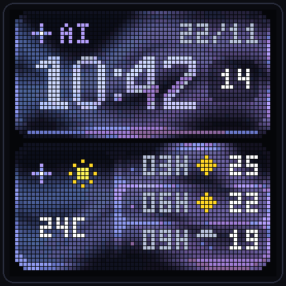

<div align="center">

# ESP32 HUB75 Clock Studio

Reloj inteligente y estación de clima para paneles LED RGB **64×64** con **ESP32**. Animaciones fluidas a **120 FPS**, diseños personalizables, estudio web integrado e instalador USB directo desde el navegador.


[](https://alexgremory255.github.io/esp32customclock/)
[](https://alexgremory255.github.io/esp32customclock/?flash=1#flash)

</div>

---

## Vista previa

<div align="center">
  <a href="https://alexgremory255.github.io/esp32customclock/">
    
  </a>
  <p>
    <sub>GitHub no permite ejecutar vistas interactivas dentro de archivos Markdown; haz clic en la imagen superior para abrir el <strong>simulador en tiempo real</strong> y probar todos los diseños, fondos y paletas de color.</sub>
  </p>
</div>

---

## Características

- **Animaciones a 120 FPS:** Transiciones fluidas, degradados suaves sin saltos visuales y segundero con barrido continuo.
- **20 diseños de reloj:** 10 carátulas horizontales, 10 verticales y soporte para modo a pantalla completa.
- **Personalización total:** 21 fondos animados, 41 paletas de color (sólidas, duales, triples e iridiscentes), tarjetas translúcidas y texto estilo cristal.
- **Clima y hora automáticos:** Temperatura actual, íconos, pronóstico próximo de OpenWeatherMap y sincronización automática de hora por internet.
- **Estudio web y actualizaciones OTA:** Configura todo desde tu celular o PC sin recargar código por cable y actualiza el reloj por Wi-Fi con un clic.
- **Instalador USB en navegador:** Carga el firmware desde cero en cualquier ESP32 nuevo sin instalar programas ni controladores adicionales.

---

## Requisitos de hardware

Compatible con el mismo estándar de hardware que **Clockwise / ClockWise Plus**:

| Componente | Especificación recomendada | Notas |
| :--- | :--- | :--- |
| **Panel LED** | Matriz RGB **64×64** con conector **HUB75 / HUB75E** | Panel de escaneo `1/32` (requiere pin `E`). Se recomienda pitch **P2.5** o **P3** para escritorio o pared. |
| **Microcontrolador** | **ESP32 DevKit** (`ESP32-WROOM` o `ESP32-WROVER`) | Compatible únicamente con ESP32 clásico (no ESP8266). |
| **Fuente de poder** | **5V DC regulada, 3A – 4A** (mínimo) | Indispensable para alimentar el panel de forma estable en brillo medio/alto. |
| **PCB opcional** | **WiseShield-32** (estándar Clockwise) | Permite conectar el ESP32 directamente al panel sin usar cables puente. |

> **Importante sobre la alimentación:** No alimentes el panel LED desde el pin `5V` del ESP32 ni por USB. Conecta la fuente de 5V/3A–4A directo al conector de energía del panel y alimenta el ESP32 en paralelo compartiendo **tierra (`GND`) común** entre la fuente, el panel y la placa.

---

## Conexiones (Pinout HUB75)

Usa el mapa de pines estándar de **Clockwise / WiseShield-32** definido en `src/config.h`:

| Pin HUB75 | GPIO ESP32 | Función | Pin HUB75 | GPIO ESP32 | Función |
| :--- | :---: | :--- | :--- | :---: | :--- |
| **R1** | `25` | Rojo (mitad superior) | **A** | `23` | Línea de dirección A |
| **G1** | `26` | Verde (mitad superior) | **B** | `19` | Línea de dirección B |
| **B1** | `27` | Azul (mitad superior) | **C** | `5` | Línea de dirección C |
| **R2** | `14` | Rojo (mitad inferior) | **D** | `17` | Línea de dirección D |
| **G2** | `12` | Verde (mitad inferior) | **E** | `18` | Línea de dirección E |
| **B2** | `13` | Azul (mitad inferior) | **CLK** | `16` | Señal de reloj |
| **LAT** | `4` | Latch de fila | **OE** | `15` | Control de brillo |
| **GND** | `GND` | Tierra común | | | |

---

## Instalación rápida (ESP32 nuevo por USB)

Para cargar el firmware completo en un ESP32 sin configurar directamente desde el navegador:

1. Conecta tu ESP32 por USB y abre **[alexgremory255.github.io/esp32customclock/?flash=1#flash](https://alexgremory255.github.io/esp32customclock/?flash=1#flash)** en **Google Chrome** o **Microsoft Edge**.
2. Presiona **Flashear USB**, elige el puerto de tu placa y espera a que termine el proceso *(si tu placa no entra sola en modo descarga, mantén presionado el botón `BOOT` mientras inicia)*.
3. Al encender por primera vez, el reloj abrirá la red Wi-Fi **`ESP32-Clock`**. Conéctate desde tu teléfono para guardar tu Wi-Fi, ciudad y zona horaria.
4. Cuando se conecte a tu red, abre la IP mostrada en pantalla (o `http://esp32clock.local`) o entra al **Estudio Web** para elegir tu diseño, fondo, colores y brillo.

> **Atajos del botón físico `BOOT` (`GPIO 0`):** mantenerlo presionado 3 segundos al encender borra los ajustes guardados; presionarlo brevemente con el reloj encendido muestra en pantalla su IP local y el tiempo activo.

---

## Compilación local (PlatformIO)

Dependencias configuradas en `platformio.ini`:
- `mrfaptastic/ESP32 HUB75 LED MATRIX PANEL DMA Display @ 3.0.15`
- `adafruit/Adafruit GFX Library @ 1.11.11`
- `bblanchon/ArduinoJson @ 6.21.3`

```bash
# Compilar y subir por USB
pio run -e usb -t upload

# Abrir monitor serie
pio device monitor -b 115200
```

La interfaz web ([`index.html`](index.html)) se empaqueta automáticamente antes de cada compilación mediante `publicar_ota.py`.
